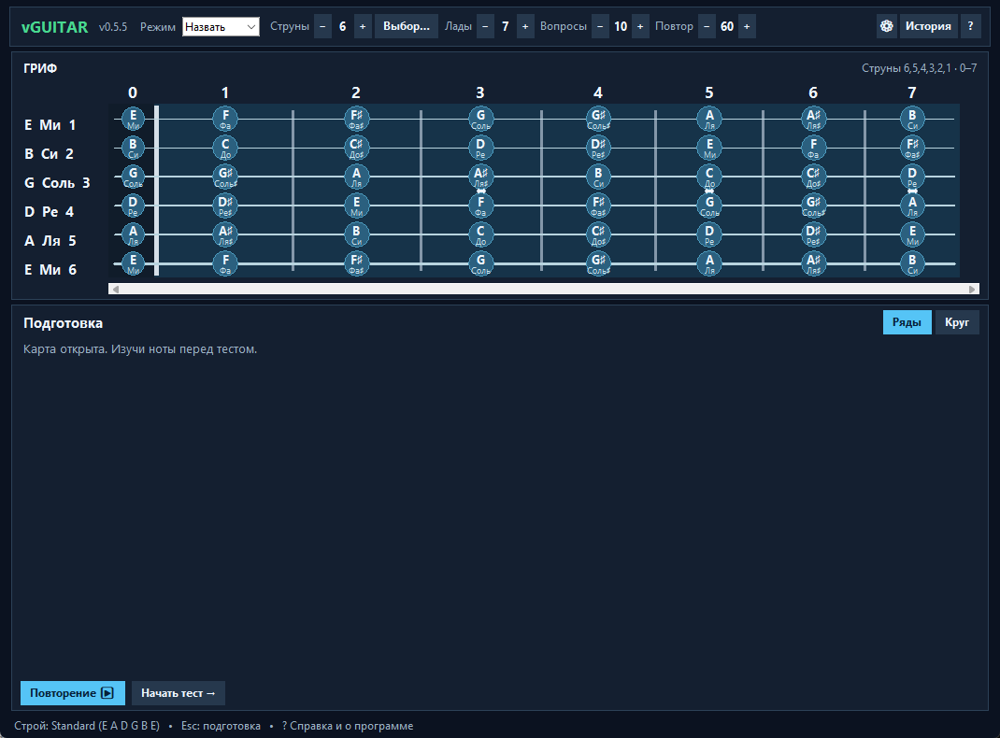

<p align="center">
  
</p>

<h1 align="center">vGUITAR Note Trainer</h1>

<p align="center"><strong>Интерактивный тренажёр гитарного грифа для Windows</strong></p>

<p align="center"><strong>Русский</strong> · <a href="README.en.md">English</a></p>

<p align="center">
  <a href="https://github.com/TheColdVoid1337/vGUITAR/releases">Релизы</a> ·
  <a href="vguitar/docs/USER_GUIDE.md">Руководство</a> ·
  <a href="vguitar/docs/CHANGELOG.md">История изменений</a>
</p>

**Текущая версия: 0.5.5 (alpha)** · Python 3.9+ / Tkinter · [MIT License](LICENSE)

**vGUITAR Note Trainer** — настольное приложение для изучения расположения нот на гитаре, интервалов, гамм и аккордовых аппликатур. Тренажёр предлагает упражнения на распознавание нот, их поиск на грифе и определение на слух, а также отдельные режимы для гамм, CAGED, power chords и трезвучий.

Программа работает локально, без регистрации. Для первоначальной установки зависимостей может потребоваться интернет.



*Снимок для ознакомления: некоторые детали интерфейса могут отличаться от v0.5.5.*

## Возможности

- **Распознавание нот.** Название ноты по струне и ладу, обратный поиск позиции и задания на слух.
- **Гриф и его внешний вид.** Любые отдельные струны или сочетания для упражнений на ладах 0–24. Визуальные накладки Original/Ebony/Maple/Rosewood, древесная текстура с рандомизацией, варианты материалов и размеров струн, порожка, ладов и маркеров.
- **Гаммы и аппликатуры.** Мажор, натуральный минор, дорийский и фригийский лады, две пентатоники и блюзовая гамма. Семь позиций 3NPS для семиступенных гамм и пять боксов для пентатоник и блюза.
- **CAGED.** Пять мажорных аккордовых форм и связанные с ними карты мажорной и натуральной минорной гаммы.
- **Аккордовые формы.** Power chords R–5 и R–5–8, мажорные, минорные и уменьшённые трезвучия, обращения и группы струн. Для форм доступны подписи нот, ступеней и рекомендуемых пальцев.
- **Звук и строй.** Синтезированные звуки струн, настройка вывода звука и альтернативные гитарные строи.
- **Отслеживание прогресса.** Точность и время ответа, история занятий, локальные настройки и JSON-экспорт результатов.
- **Два языка.** При первом запуске без preferences кнопки **ENGLISH / РУССКИЙ**; дальнейшее переключение через **⚙ → Язык**.

## Установка

**Требования:** Windows, Python 3.9 или новее с поддержкой Tkinter и устройство вывода звука.

Клонируйте репозиторий и запустите приложение:

```powershell
git clone https://github.com/TheColdVoid1337/vGUITAR.git
cd vGUITAR
.\RUN.bat
```

Также можно [скачать исходный код](https://github.com/TheColdVoid1337/vGUITAR/releases) и запустить `RUN.bat` из распакованной папки.

При первом запуске сценарий создаёт виртуальное окружение `.venv` и при необходимости устанавливает зависимости из `requirements.txt`. Готовый установщик Windows в текущем выпуске не предоставляется.

## Обновление и локальные данные

После получения обновлений команда `git pull --ff-only origin main` обновляет исходники. Повторный запуск осуществляется через `RUN.bat`.

Настройки и результаты занятий сохраняются локально в `vguitar/data/` и не включаются в Git. При первом запуске после обновления приложение безопасно скопирует прежние JSON-файлы из корневых `settings/` и `results/`, не удаляя оригиналы. После проверки истории в приложении старые копии можно убрать вручную.

## Начало работы

1. Выберите **«Назвать»**, **«Найти»** или **«На слух»** в выпадающем списке **«Режим»**.
2. Укажите струны, диапазон ладов и количество вопросов. Кнопка **«Выбор…»** позволяет включать отдельные струны независимо друг от друга.
3. При необходимости используйте предварительное повторение, затем начните тест.
4. Отвечайте на вопросы: выбирайте название ноты или её позицию на грифе.
5. Просматривайте результаты в **«Истории»**. Отчёты можно копировать в формате JSON.

Для изучения музыкальных структур предусмотрены режимы **«Гаммы»**, **«CAGED»** и **«Формы»**. Их настройки позволяют менять тональность, аппликатуру и параметры задания.

Кнопка **⚙** открывает вкладки **Строй / Аудио / Гриф / Язык**. История доступна по иконке **📖**, а справка — по **?**. Кнопки **«♫ Тест»** и **«Лог звука»** расположены внутри вкладки **Аудио**.

Во вкладке **Гриф** нажимайте непосредственно на превью накладок: **Оригинальная**, **Черное дерево (Ebony)**, **Клён (Maple)** и **Палисандр (Rosewood)**. Можно включить древесную текстуру и выбрать новый рисунок кнопкой **«Рандомизировать»** (не для виртуальной Оригинальной). Дополнительно доступны калибры струн **8–38…12–56**, материал струн, порожек толщиной **3–8 мм с шагом 0,5 мм** и его материал, коронки ладов вплоть до **SINTOMS 4.3mm**, цвет ладовой проволоки и размер маркеров. Изменения сразу видны и сохраняются кнопкой **«Сохранить»** или откатываются кнопкой **«Отмена»**. Все эти параметры влияют только на графику, а не на звук или строй.

Полное описание режимов, управления и настроек — в [руководстве пользователя](vguitar/docs/USER_GUIDE.md).

## Документация

- [Руководство пользователя](vguitar/docs/USER_GUIDE.md)
- [История изменений](vguitar/docs/CHANGELOG.md)
- [Примечания к версии 0.5.5](vguitar/docs/releases/v0.5.5.md)
- [Предыдущий выпуск 0.5.4](vguitar/docs/releases/v0.5.4.md)
- [Исторические версии](vguitar/docs/releases/HISTORY.md)
- [Участие в разработке](CONTRIBUTING.md)
- [Политика безопасности](SECURITY.md)

## Об авторе и проекте

Кнопка **?** в верхней панели открывает окно «О программе» с краткой справкой, версией, иконкой и ссылками на [профиль разработчика](https://github.com/TheColdVoid1337) и [репозиторий](https://github.com/TheColdVoid1337/vGUITAR).

## Статус проекта

vGUITAR находится на этапе **alpha**. Приложение предназначено для самостоятельной практики; отображаемые варианты постановки пальцев служат рекомендациями. Поддержка некоторых традиционных аппликатур зависит от интервалов между струнами в выбранном строе.

О проблемах и предложениях можно сообщать через [GitHub Issues](https://github.com/TheColdVoid1337/vGUITAR/issues).

## Лицензия

Проект распространяется по лицензии [MIT](LICENSE).
